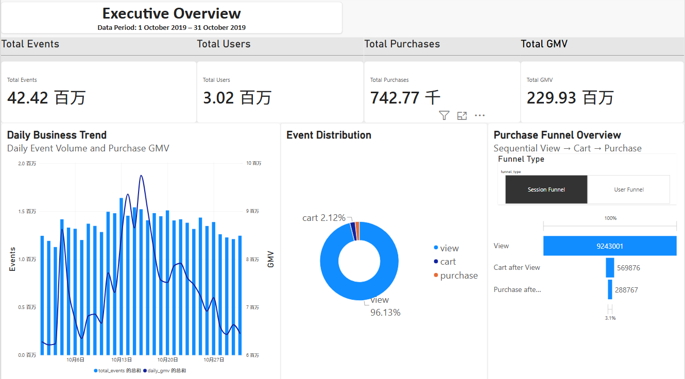
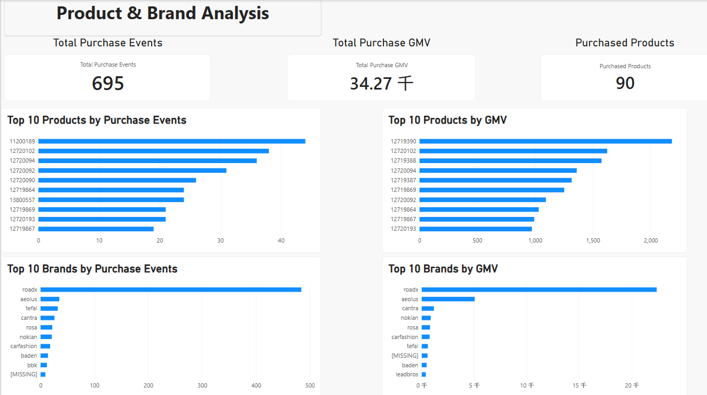
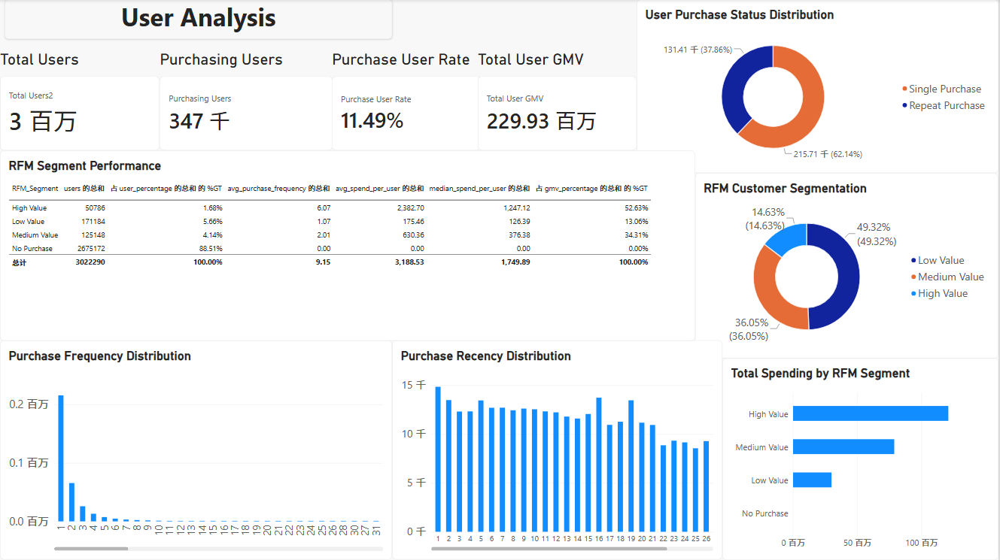
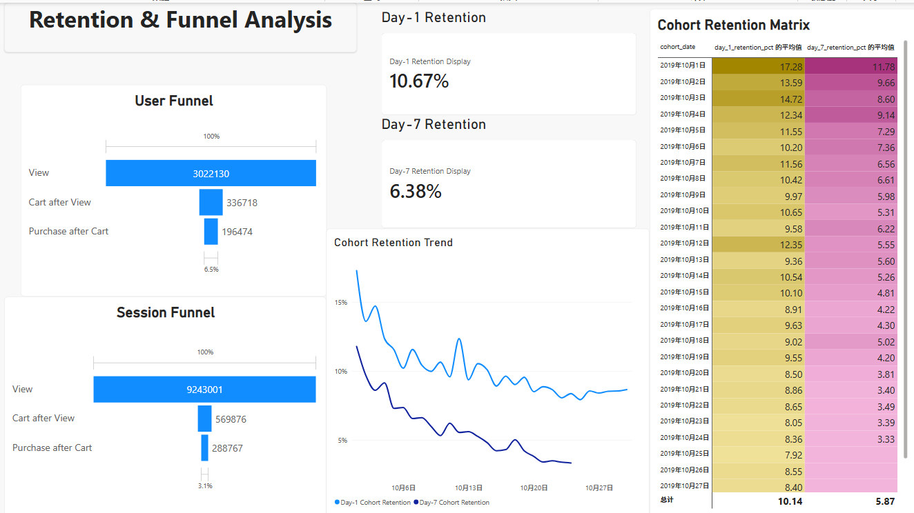
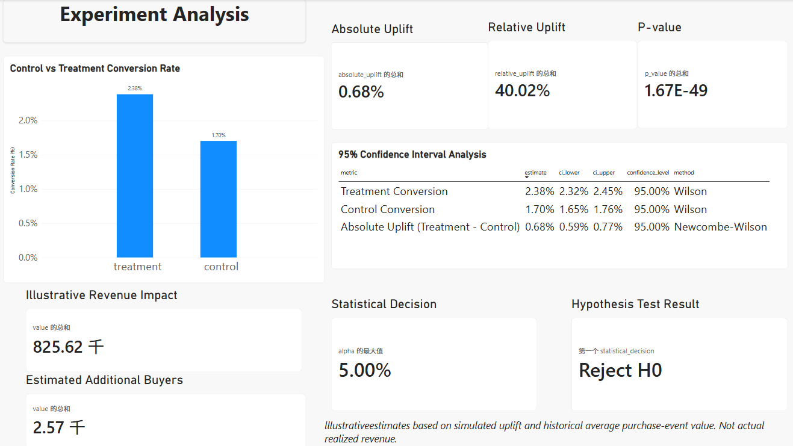

# E-Commerce Funnel Optimization & Experimentation Dashboard

**SQL · Python · Pandas · NumPy · SciPy · StatsModels · Power BI**

[中文说明](./README_CN.md)

An end-to-end e-commerce analytics project covering user behaviour, product performance, customer retention, ordered conversion funnels, user segmentation and simulation-based experimentation. The Power BI report brings the analysis together in five interactive pages.

> **Experiment boundary:** Historical user behaviour is derived from the dataset. The A/B experiment is simulation-based: no coupon was actually delivered and no post-intervention purchase behaviour was observed. Treatment represents a simulated condition, not confirmed coupon recipients. Statistical significance in the simulation does not establish real-world causal effectiveness.

## 1. Project Overview

The project transforms large-scale e-commerce event data into business-facing analysis through data preparation, SQL analysis, Python-based processing and Power BI reporting.

### Current Analytical Data Profile

| Metric | Result |
|---|---:|
| User Dimension records | 3,022,290 |
| Total event records | 42,418,540 |
| View events | 40,777,330 |
| Cart events | 898,443 |
| Purchase events | 742,773 |
| User-session pairs | 9,244,770 |
| Purchase-event GMV | 229,933,200 |

Purchase-event GMV is calculated from purchase-event values. It should not automatically be interpreted as order-level revenue unless validated against order-level records.

## 2. Analytical Workflow

1. Data preparation and validation.
2. SQL-based user, product, session and event-level analysis.
3. User behaviour, customer value and product/brand analysis.
4. Simulation-based experiment design and statistical evaluation.
5. Interactive Power BI dashboard development.

## 3. Power BI Dashboard Showcase

### Page 1 — Executive Overview



A high-level view of business performance, core KPIs and activity trends.

### Page 2 — Product & Brand Analysis



Explores product and brand performance, category contribution and sales distribution.

### Page 3 — User Analysis



Examines user purchase behaviour, activity and customer value, supporting user-level comparison and segmentation.

### Page 4 — Retention & Funnel Analysis



Combines user- and session-level ordered funnels with cohort retention analysis.

- Day-1 Retention: **10.67%**
- Day-7 Retention: **6.38%**

Cohort-level retention varies by cohort date.

### Page 5 — Experiment Analysis



Presents the simulation-based experiment comparison, effect sizes, confidence intervals, statistical decision and illustrative business-impact scenario.

| Metric | Current Dashboard Result |
|---|---:|
| Treatment conversion rate | 2.38% |
| Control conversion rate | 1.70% |
| Absolute uplift | 0.68 percentage points |
| Relative uplift | 40.02% |
| P-value | 1.67 × 10⁻⁴⁹ |
| Treatment conversion 95% CI | 2.32%–2.45% |
| Control conversion 95% CI | 1.65%–1.76% |
| Absolute uplift 95% CI | 0.59–0.77 percentage points |
| Illustrative additional buyers | Approximately 2.57 thousand |
| Illustrative revenue impact | Approximately 825.62 thousand |

The dashboard reports **Reject H0** at α = 0.05.

Additional buyers and revenue impact are illustrative estimates based on simulated uplift and historical purchase-event value. They are not realized revenue, observed incremental buyers or a validated forecast.

## 4. Funnel and Retention Methodology

User-level and session-level funnels are different analytical units and use different denominators. Ordered funnel stages describe observed event sequences; they do not independently explain why a user abandoned or completed a purchase.

Cohort retention is presented by cohort date. Headline retention cards and cohort-matrix aggregates may use different aggregation logic and should be interpreted according to their displayed definitions.

## 5. Simulation-Based Experimentation

The experiment analysis demonstrates:

- Eligible population definition using historical behaviour.
- Simulated Control and Treatment assignment.
- Binary outcome generation using predefined probabilities.
- Conversion-rate comparison and uplift calculation.
- Confidence interval estimation and two-proportion significance testing.
- An explicitly illustrative business-impact scenario.

The P-value and confidence intervals describe generated simulation outcomes only. They do not prove that a real coupon intervention would produce the same uplift.

## 6. Technology Stack

| Area | Tools |
|---|---|
| Data querying and transformation | SQL, MySQL |
| Data processing | Python, Pandas, NumPy |
| Statistical analysis | SciPy, StatsModels |
| Notebook development | Jupyter Notebook |
| Business intelligence | Power BI |

## 7. Repository Structure

```text
E-Commerce-Funnel-Optimization-Experimentation/
├── assets/
│   ├── page1_executive_overview.png
│   ├── page2_product_analysis.png
│   ├── page3_user_analysis.png
│   ├── page4_retention_funnel.png
│   └── page5_experiment_analysis.png
├── result_data/
│   ├── Executive_Overview.png
│   ├── Product & Brand_Analysis.png
│   ├── User_Analysis.png
│   ├── Retention & Funnel_Analysis.png
│   └── Experiment_Analysis.png
├── ecommerce_analysis.sql
├── ecommerce_analysis.ipynb
├── ab_test_real_users.ipynb
├── README.md
└── README_CN.md
```


## 8. Scope and Limitations

- Dashboard metrics should be interpreted using the grain and definitions of their underlying tables.
- User-level, session-level and event-level counts are not interchangeable.
- Ordered funnels describe observed sequences, not user motivation or causal reasons for drop-off.
- Retention values depend on cohort definitions, observation windows and aggregation logic.
- The A/B workflow is simulation-based; there was no actual coupon delivery or observed post-intervention outcome.
- Statistical significance in simulated data does not establish real-world intervention effectiveness.
- Additional buyers and revenue impact are illustrative estimates, not realized business outcomes.
- Purchase-event value is not necessarily equivalent to order-level AOV or order-level GMV.

---

**Built with SQL, Python, Pandas, NumPy, SciPy, StatsModels and Power BI.**
