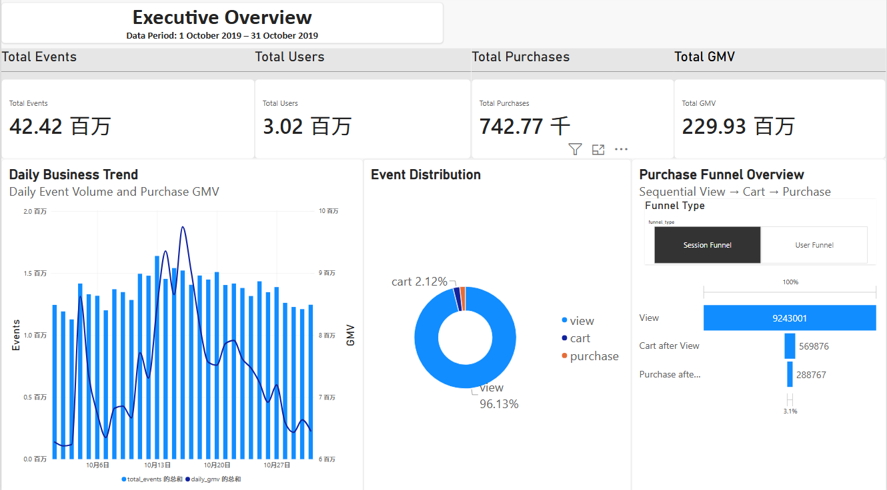
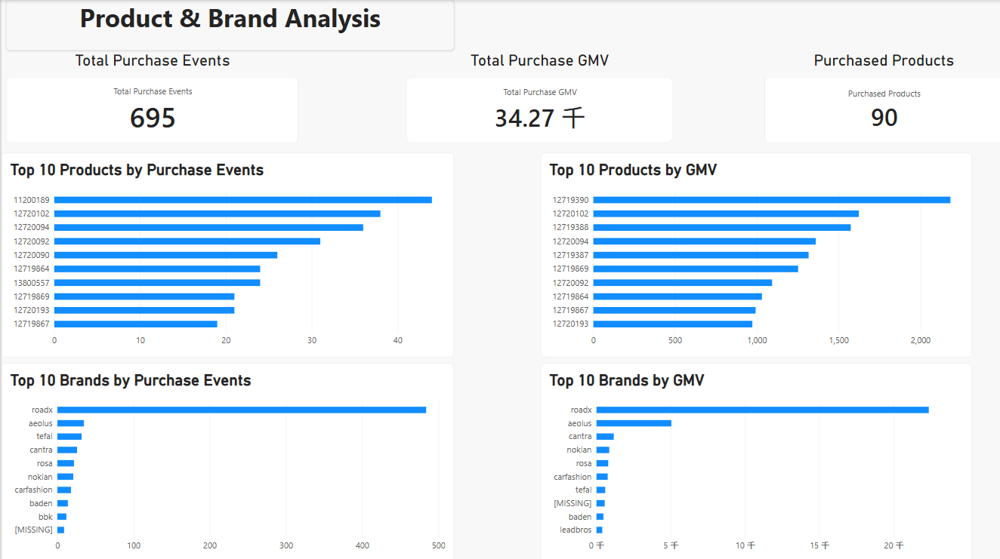
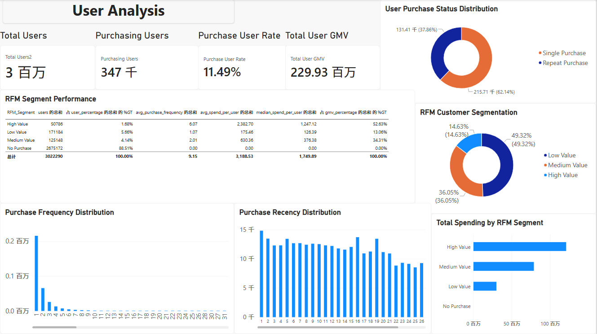
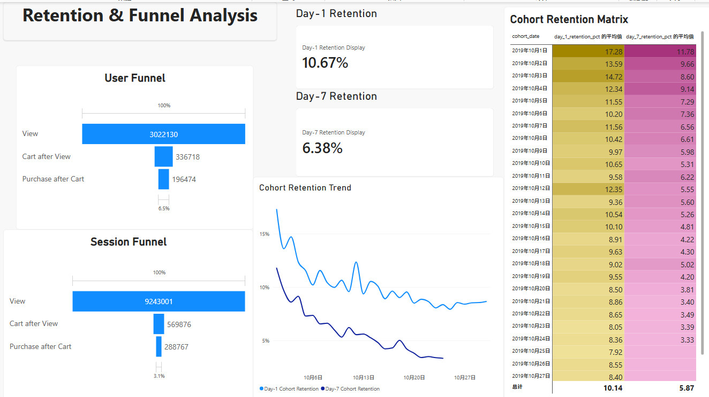
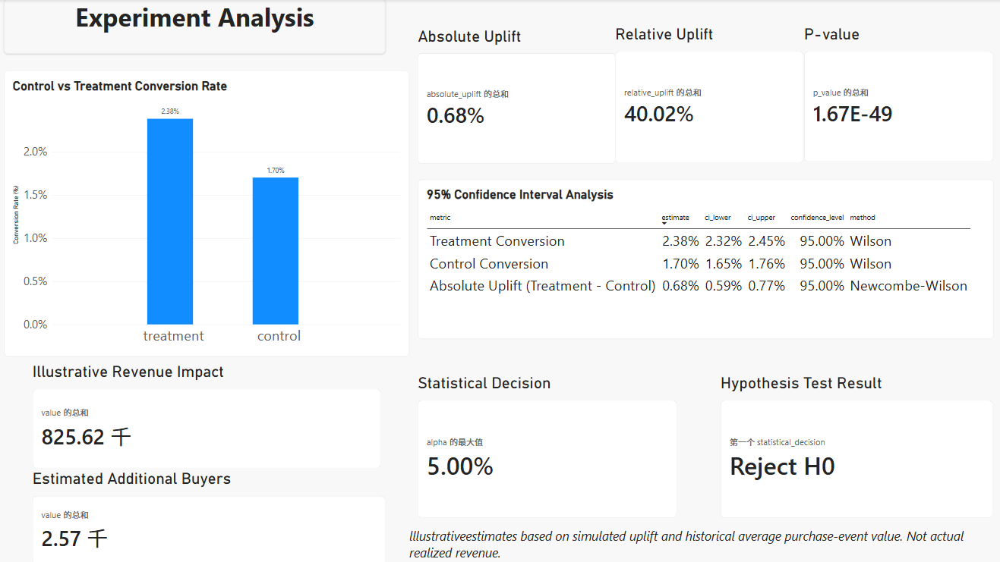

# 电商用户行为分析、转化漏斗优化与实验分析 Dashboard

**SQL · Python · Pandas · NumPy · SciPy · StatsModels · Power BI**

[English README](./README.md) | 中文项目说明

本项目围绕电商用户行为数据，构建从数据处理、SQL 分析、用户与商品分析、留存及转化漏斗，到模拟实验评估的完整分析流程，并通过 Power BI 将结果整合为五个交互式 Dashboard 页面。

> **实验性质说明：** 历史用户行为来自数据集。A/B Testing 部分属于模拟实验：项目没有实际向用户发送优惠券，也没有观察真实干预后的购买行为。Treatment 代表模拟实验条件，并不意味着这些用户实际收到了优惠券。模拟结果的统计显著性不能证明真实营销策略的因果效果。

## 一、项目概述

项目通过 SQL、Python 和 Power BI，将大规模电商事件数据转化为可用于业务观察和决策支持的分析结果。

### 当前分析数据概况

| 指标 | 当前分析结果 |
|---|---:|
| User Dimension 用户记录数 | 3,022,290 |
| 事件总数 | 42,418,540 |
| View Events | 40,777,330 |
| Cart Events | 898,443 |
| Purchase Events | 742,773 |
| User-Session Pairs | 9,244,770 |
| Purchase-event GMV | 229,933,200 |

Purchase-event GMV 根据 Purchase 事件金额计算。除非与订单级数据完成核对，否则不能直接将其等同于订单级收入或订单级 GMV。

## 二、分析流程

1. 数据清洗、处理与验证。
2. 使用 SQL 构建用户、商品、Session 及事件层面的分析指标。
3. 分析用户购买行为、用户价值及商品和品牌表现。
4. 构建模拟实验并进行统计评估。
5. 使用 Power BI 将分析结果整合为交互式 Dashboard。

## 三、Power BI Dashboard 展示

### Page 1 — Executive Overview（整体业务概览）



从整体层面展示核心业务指标、用户活动情况及时间趋势。

### Page 2 — Product & Brand Analysis（商品与品牌分析）



分析商品及品牌表现、类别贡献和销售分布。

### Page 3 — User Analysis（用户分析）



从用户维度分析购买行为、活动情况及用户价值，支持用户群体之间的比较与分群分析。

### Page 4 — Retention & Funnel Analysis（留存与转化漏斗）



结合 User-level 与 Session-level 有序转化漏斗，以及 Cohort Retention 分析。

- Day-1 Retention：**10.67%**
- Day-7 Retention：**6.38%**

不同 Cohort 日期的留存表现有所差异。

### Page 5 — Experiment Analysis（实验分析）



展示模拟实验的 Control 与 Treatment 转化率比较、提升幅度、置信区间、统计决策及假设性商业影响估算。

| 指标 | 当前 Dashboard 结果 |
|---|---:|
| Treatment Conversion Rate | 2.38% |
| Control Conversion Rate | 1.70% |
| Absolute Uplift | 0.68 个百分点 |
| Relative Uplift | 40.02% |
| P-value | 1.67 × 10⁻⁴⁹ |
| Treatment Conversion 95% CI | 2.32%–2.45% |
| Control Conversion 95% CI | 1.65%–1.76% |
| Absolute Uplift 95% CI | 0.59–0.77 个百分点 |
| Illustrative Additional Buyers | 约 2.57 千人 |
| Illustrative Revenue Impact | 约 825.62 千 |

在 α = 0.05 的显著性水平下，Dashboard 展示的统计决策为 **Reject H0**。

新增购买人数及收入影响属于基于模拟提升幅度和历史 Purchase-event Value 得到的假设性情景估算，不代表实际新增买家、已实现收入或经过验证的业务预测。

## 四、漏斗与留存分析口径

项目区分 User-level 与 Session-level 漏斗。用户和 Session 是不同的分析单位，使用不同的统计分母，不能混为同一口径。

有序漏斗反映观察到的事件先后顺序，但不能单独解释用户放弃购买或完成购买的具体原因。

Cohort Retention 按 Cohort 日期展示。页面顶部的留存指标卡与 Cohort 矩阵汇总值可能采用不同的聚合逻辑，应根据各自的指标定义进行解读。

## 五、模拟实验分析

实验分析页面展示以下流程：

- 根据历史用户行为筛选符合条件的用户。
- 将符合条件的用户分配至模拟 Control 和 Treatment 组。
- 根据预设概率生成二元模拟购买结果。
- 比较两组转化率并计算 Absolute Uplift 和 Relative Uplift。
- 计算置信区间并进行双比例显著性检验。
- 将模拟提升幅度转换为明确标注的假设性商业影响情景。

Dashboard 中的 P-value 和置信区间仅用于描述模拟生成的实验结果，不能证明真实优惠券策略能够获得相同的转化率提升。

## 六、技术栈

| 技术领域 | 使用工具 |
|---|---|
| 数据查询与转换 | SQL、MySQL |
| 数据处理 | Python、Pandas、NumPy |
| 统计分析 | SciPy、StatsModels |
| 分析开发环境 | Jupyter Notebook |
| 商业智能可视化 | Power BI |

## 七、项目目录结构

```text
E-Commerce-Funnel-Optimization-Experimentation/
├── assets/
│   ├── page1_executive_overview.png
│   ├── page2_product_analysis.png
│   ├── page3_user_analysis.png
│   ├── page4_retention_funnel.png
│   └── page5_experiment_analysis.png
├── result_data/
│   ├── Executive_Overview.png
│   ├── Product & Brand_Analysis.png
│   ├── User_Analysis.png
│   ├── Retention & Funnel_Analysis.png
│   └── Experiment_Analysis.png
├── ecommerce_analysis.sql
├── ecommerce_analysis.ipynb
├── ab_test_real_users.ipynb
├── README.md
└── README_CN.md
```


## 八、项目范围与局限性

- Dashboard 指标应结合底层数据表的粒度和具体定义进行解读。
- User-level、Session-level 和 Event-level 数量不是可互换的统计指标。
- 有序漏斗描述观察到的行为顺序，不能单独证明用户流失或购买决策的原因。
- 留存结果受 Cohort 定义、观察窗口及聚合方式影响。
- A/B Testing 为模拟实验，没有实际优惠券投放，也没有真实干预后的购买结果。
- 模拟数据中的统计显著性不能证明真实营销策略的有效性。
- 新增购买人数和收入影响属于假设性估算，不代表实际业务成果。
- Purchase-event Value 不一定等同于订单级 AOV 或订单级 GMV。

---

**Built with SQL, Python, Pandas, NumPy, SciPy, StatsModels and Power BI.**
